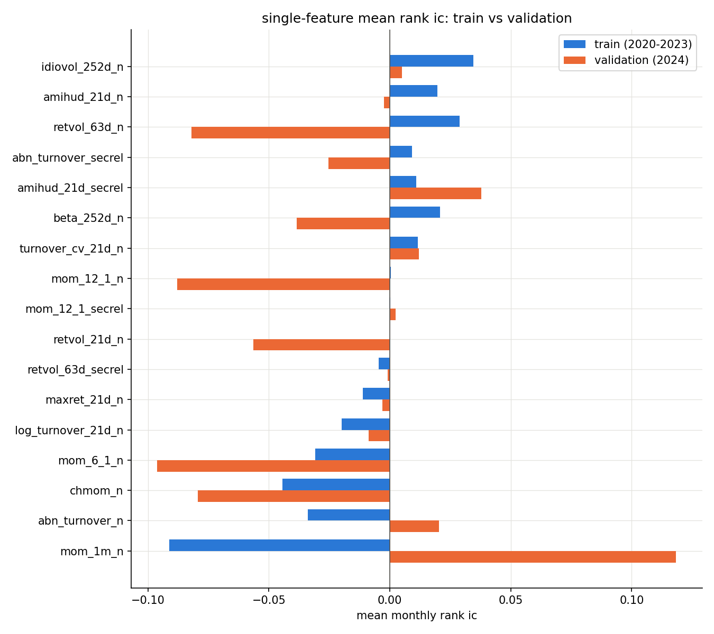
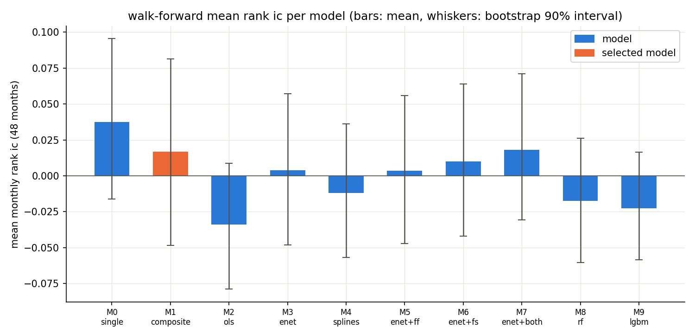
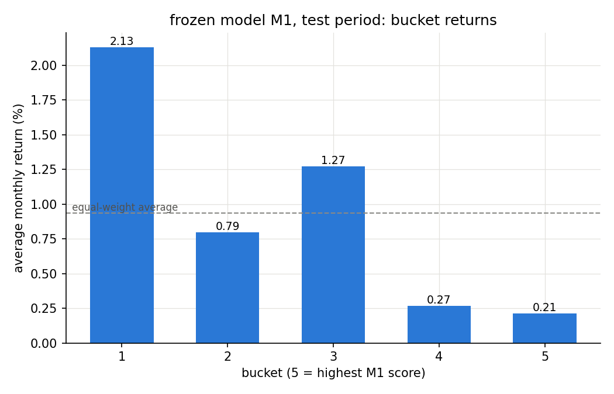
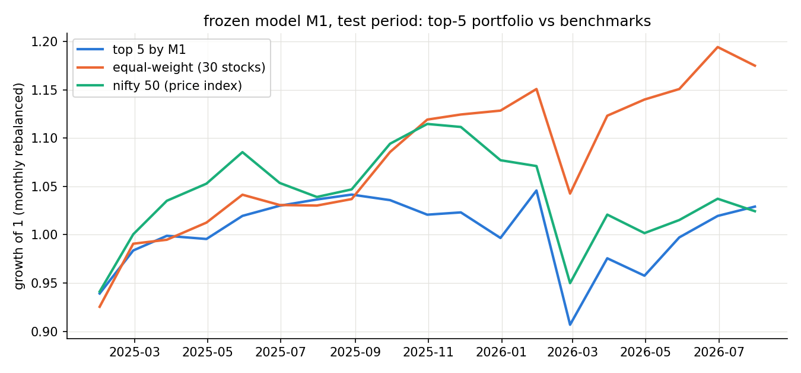
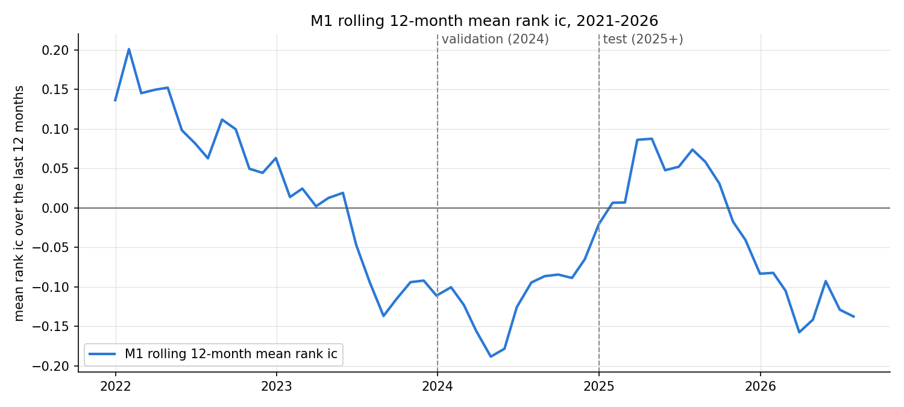
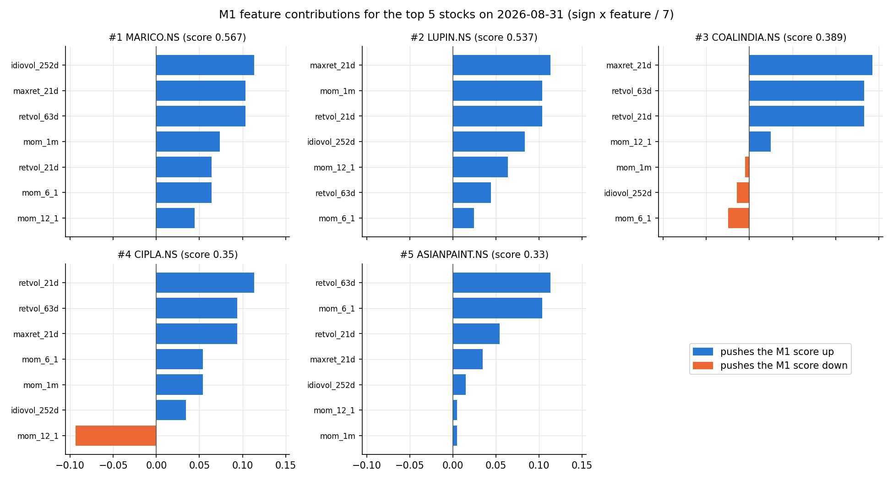

# Cross-sectional stock ranking with machine learning on a 30-stock Nifty universe

A research project by Archit Panda(me) for the Quant Team of the Finance & Economics Club (FEC), Sardar Patel Institute of Technology (SPIT), Mumbai.

## 1. Summary

**Question.** Can a machine-learning model rank 30 large Indian stocks by their expected *relative* return next month, using only past prices and trading volume? And do nonlinear models and feature interactions rank better than a simple linear model?

**Approach.** At the end of every month, each stock is described by 13 momentum, volatility and liquidity features plus 4 sector-relative variants. Features are rank-normalized within each month, so the models only see where a stock stands relative to the other 29. Ten models of increasing complexity (a single feature, a rule-based composite, OLS, elastic net, splines, linear models with interactions, random forest and LightGBM) were compared in a walk-forward test over 2021-2024. The model-selection rule was fixed before any results were seen. The selected model was then run exactly once on a frozen test period (January 2025 to July 2026).

**Result in plain words.** The hypothesis was not supported. No model, simple or complex, showed a reliable ability to rank these stocks: all bootstrap 90% intervals for the 48-month walk-forward rank IC include zero, and every model had a negative rank IC in the 2024 validation year. Because of the pre-registered selection rule, the selected model was the simple equal-weight composite M1 (it was the fallback, not a winner). On the unseen test period M1 scored a **mean monthly rank IC of -0.090** (90% interval -0.184 to +0.004): its ranking was, if anything, backwards. Adding nonlinearity, interactions or trees changed the walk-forward IC by amounts far smaller than the statistical noise. The main value of the project is the protocol: a leak-checked pipeline, a selection rule fixed in advance, and a test set that was used once.

## 2. Hypothesis

> Nonlinear interactions between momentum, volatility and liquidity improve cross-sectional ranking of stock returns, beyond what a linear model of the same features achieves.

This follows the motivation of Gu, Kelly and Xiu (2020), who found that trees and neural networks gain mainly from interactions. The project tests whether that carries over to a very small universe (30 stocks). The hypothesis is judged by out-of-sample rank IC, and each added piece (nonlinearity within features, feature x feature interactions, feature x market-state interactions, trees) is compared against the plain elastic net (M3).

## 3. Data

- **Universe:** 30 Nifty stocks (current large caps, 15 sectors), daily, 2019-01-01 to 2026-09-18, about 57,300 rows.
- **Content:** prices (open, high, low, close, adjusted versions), volume, rupee turnover and returns. No fundamentals.
- **Format:** one row per (Date, Ticker), columns `Date, Ticker, Company, Sector, Open, High, Low, Close, Volume, Adj_Open, Adj_High, Adj_Low, Adj_Close, Adj_Volume, Turnover, Daily_Return, Log_Return`.
- **Known gaps:** 2026-01-15 is missing for all stocks (exchange closure). Five dates in 2025-2026 have zero volume and zero return for all stocks and look like non-trading days (see limitations).
- **The data is not included in this repository** (`data/` is git-ignored). To reproduce, place the raw file at `data/raw/data_v1.csv` with the columns above. Notebook 01 validates it and writes `data/processed/panel.csv`. The raw file is never modified.
- **Benchmarks:** the equal-weight benchmark is built from the 30 stocks. The Nifty 50 benchmark (`^NSEI`, a price index) is downloaded with `yfinance` in notebook 05 and cached in `data/processed/benchmark_nifty.csv`. If `yfinance` is not installed the notebook falls back to the cached file.

## 4. Research protocol

| Step | Choice |
|---|---|
| Decision dates | Last trading day of each month (92 dates, 2019-01-31 to 2026-08-31) |
| Label | 1-month forward return from adjusted close, month-end to next month-end. 3-month and 6-month returns are robustness checks only |
| Fitting target | Cross-sectional percentile rank of the forward return within the month, centered (`rank - 0.5`) |
| Features | Rank-normalized to [-1, 1] within each month. Missing values are set to 0 (the middle rank). Normalization statistics never cross months |
| Sector-relative features | Value minus the sector median that month, then rank-normalized. Set to missing (then 0) for sectors with fewer than 3 stocks |
| Market-state variables | One value per month, same for all stocks, with an expanding-window z-score (current and past values only, at least 12 months) |
| Splits (chronological) | Warm-up 2019 (lost to the 12-month lookback), train 2020-2023, validation 2024, test 2025 to July 2026 (19 labelled months) |
| Walk-forward | For each year 2021-2024, train on all earlier years and predict that year: 48 out-of-sample months. Hyperparameters are tuned on the last year before the prediction year only (2021 uses fixed defaults, since only 2020 exists) |
| Selection rule | Fixed before the results were seen: (1) eligible = 2024 validation mean IC > 0; (2) pick the highest 48-month walk-forward IC; (3) take the simplest eligible model within 0.01 of it; (4) if none is eligible, pick the composite M1 |
| Frozen test | The selected model is applied once to the test period, with no changes |

Hard rules enforced by automated checks: no lookahead (a feature on a decision date uses only data up to that date), no use of test data for any choice, and no modification of the raw data. The leakage test multiplies all prices and turnover after a cutoff date by 1.5 and confirms that every feature on earlier dates is unchanged. A second test scrambles the labels of later years and confirms earlier walk-forward predictions do not move.

## 5. Features

All features are computed from adjusted prices (returns, momentum) or rupee turnover (liquidity), then sampled at each month-end. "Prior" is the direction assumed from the literature before looking at results (none = no strong prior).

| Feature | Definition | Prior |
|---|---|---|
| `mom_1m` | Return over the last month (t-1 to t) | negative (short-term reversal) |
| `mom_6_1` | Return from t-6 to t-1, skipping the latest month | positive |
| `mom_12_1` | Return from t-12 to t-1, skipping the latest month | positive |
| `chmom` | `mom_6_1` minus the return from t-12 to t-7 | none |
| `retvol_21d`, `retvol_63d` | Standard deviation of daily returns over 21 / 63 trading days | negative |
| `maxret_21d` | Largest daily return in the last 21 days | negative |
| `beta_252d` | Rolling covariance with the equal-weight market divided by market variance, 252 days | none |
| `idiovol_252d` | Standard deviation of the return not explained by the market (stock minus beta times market), 252 days | negative |
| `log_turnover_21d` | Log of mean daily rupee turnover over 21 days | none |
| `turnover_cv_21d` | Standard deviation divided by mean of turnover over 21 days | none |
| `abn_turnover` | Mean turnover over 21 days divided by mean turnover over 252 days | none |
| `amihud_21d` | Mean of absolute daily return divided by turnover over 21 days (x 1e9; zero turnover treated as missing) | none |
| `mom_12_1_secrel`, `retvol_63d_secrel`, `abn_turnover_secrel`, `amihud_21d_secrel` | The raw feature minus its sector median in that month, then rank-normalized | same as the raw feature |
| `mkt_ret_1m`, `mkt_ret_12m` | Equal-weight market return over the last 1 / 12 months | state variable |
| `mkt_vol_63d` | Standard deviation of daily market returns over 63 days | state variable |
| `xs_dispersion` | Cross-sectional standard deviation of the 30 stocks' `mom_1m` | state variable |
| `*_z` versions of the four state variables | Expanding-window z-score | state variable |

Every rolling window uses its full length (`min_periods` equals the window) and looks backward only. State variables are the same for all 30 stocks in a month, so they can only help through interactions with stock features.

## 6. Results

All numbers below come from the files in `reports/`. "IC" is the monthly Spearman rank correlation between a model's score and the realized 1-month forward return across the 30 stocks, averaged over months.

### 6.1 Single-feature baselines

Each of the 17 normalized features was evaluated alone on train (2020-2023) and validation (2024). Full table: [`reports/single_feature_results.csv`](reports/single_feature_results.csv).

- Almost nothing is distinguishable from noise. Only one feature has a train |t-stat| above 2: `mom_1m` (train IC -0.091, t = -2.6, i.e. short-term reversal).
- `mom_1m` then flipped sign in validation (IC +0.118). Seven of the 17 features flip sign between train and validation.
- Three features disagree with the literature on train: `idiovol_252d` (positive, expected negative), `retvol_63d` and `mom_6_1`.
- `mom_12_1`, the classic momentum feature, has a train IC of 0.000.


*Figure 1. Mean monthly rank IC of each single feature on train (blue) and validation (orange).*

### 6.2 Model ladder (walk-forward 2021-2024)

| Model | Description | Features | 48-month IC | 90% bootstrap interval | 2024 IC |
|---|---|---|---|---|---|
| M0 | Best single feature (`mom_1m`, sign from train) | 1 | +0.037 | -0.016 to +0.096 | -0.118 |
| **M1** | **Equal-weight composite of 7 features, literature signs** | 7 | **+0.017** | -0.048 to +0.081 | -0.021 |
| M2 | OLS | 17 | -0.034 | -0.079 to +0.009 | -0.090 |
| M3 | Elastic net | 17 | +0.004 | -0.048 to +0.057 | -0.105 |
| M4 | Splines + ridge | 17 | -0.012 | -0.057 to +0.036 | -0.085 |
| M5 | Elastic net + feature x feature | 26 | +0.004 | -0.047 to +0.056 | -0.102 |
| M6 | Elastic net + feature x state | 26 | +0.010 | -0.042 to +0.064 | -0.125 |
| M7 | Elastic net + both interaction sets | 35 | +0.018 | -0.031 to +0.071 | -0.084 |
| M8 | Random forest | 20 | -0.018 | -0.060 to +0.026 | -0.060 |
| M9 | LightGBM | 20 | -0.023 | -0.059 to +0.017 | -0.060 |

Source: [`reports/model_comparison.csv`](reports/model_comparison.csv). The interval comes from resampling the 48 monthly ICs with replacement 2,000 times (seed 42). Step logs with the hyperparameters chosen each year are in [`reports/walk_forward_steps.csv`](reports/walk_forward_steps.csv).

**Selection.** No model had a positive 2024 IC, so rule 4 applied and M1 was selected. This means "no model beat zero on validation", not "M1 is good": M1's own 2024 IC is -0.021.


*Figure 2. 48-month walk-forward mean rank IC per model; whiskers are the bootstrap 90% interval; the selected model M1 is orange.*

### 6.3 Decomposition: what does extra complexity add?

Change in 48-month walk-forward IC relative to the linear elastic net (M3):

| Step | Model | 48-month IC | Change vs M3 | 90% interval |
|---|---|---|---|---|
| Linear | M3 | +0.004 | 0.000 | -0.048 to +0.057 |
| + nonlinearity within features | M4 | -0.012 | -0.016 | -0.057 to +0.036 |
| + feature x feature interactions | M5 | +0.004 | -0.000 | -0.047 to +0.056 |
| + feature x state interactions | M6 | +0.010 | +0.006 | -0.042 to +0.064 |
| + both interaction sets | M7 | +0.018 | +0.014 | -0.031 to +0.071 |
| Trees, everything | M9 | -0.023 | -0.027 | -0.059 to +0.017 |

Every change is much smaller than the width of the intervals (about 0.10), so none is distinguishable from zero. The hypothesis, that interactions improve ranking, is **not supported at this scale**. M7's best 48-month number is not evidence either: its largest coefficients involve the market-state variables, which have only 48 distinct values in the walk-forward window, and its 2024 IC is still negative (-0.084).

### 6.4 Frozen test: M1 on unseen data (January 2025 to July 2026, 19 months)

| Metric | Value |
|---|---|
| Mean monthly rank IC | **-0.090** (90% interval -0.184 to +0.004) |
| IC information ratio / t-stat | -0.354 / -1.54 |
| Months with positive IC | 42% |
| Bucket monotonicity (1 = perfect staircase) | -0.9 |
| Top-5 excess return vs equal-weight (per month) | -0.68%, beating equal-weight in 37% of months |
| Top-5 excess return vs Nifty 50 (per month) | +0.03% |
| Top-5 maximum drawdown / monthly turnover | -13.3% / 61% |
| 3-month robustness: mean IC against the 3-month return | 0.000 (17 months) |

The five buckets (bucket 1 = lowest M1 score) averaged 2.13%, 0.79%, 1.27%, 0.27% and 0.21% per month. The ordering is inverted: stocks M1 liked least did best. Starting from 1, the top-5 portfolio ended at 1.03 against 1.18 for equal-weight. Source: [`reports/test_results.csv`](reports/test_results.csv).


*Figure 3. Average monthly return by M1 score bucket on the test period (bucket 5 = highest score).*


*Figure 4. Growth of 1 for the M1 top-5 portfolio, equal-weight and the Nifty 50 price index over the test period.*

### 6.5 Post-hoc comparison of M3, M7 and M9 (not selected, not used for any decision)

| Model | Test mean IC | 90% interval | 3-month IC |
|---|---|---|---|
| M1 (selected, frozen) | -0.090 | -0.184 to +0.004 | 0.000 |
| M3 | +0.051 | -0.021 to +0.120 | +0.012 |
| M7 | +0.066 | -0.025 to +0.150 | +0.074 |
| M9 | +0.061 | +0.005 to +0.116 | +0.014 |

These are shown for transparency only. They must not be used to pick a different model: the selection rule is part of the protocol, and choosing among models after seeing test results would turn the test set into a second validation set (hard rule 3). The numbers also come with their own caveats: three models were looked at in one 19-month window, the 2026 refit used 2025 labels, and the same models had negative IC in 2024. Source: [`reports/test_results_all_models.csv`](reports/test_results_all_models.csv).

### 6.6 Regimes and decay of the M1 signal

Descriptive only (not used for selection). Mean M1 rank IC over all 67 out-of-sample months (2021-2026):

| Regime | Months | Mean IC |
|---|---|---|
| High / low market volatility | 33 / 34 | +0.026 / -0.052 |
| Up / down market (trailing month) | 48 / 19 | -0.028 / +0.024 |
| High / low cross-sectional dispersion | 33 / 34 | -0.004 / -0.022 |

Monthly IC has a standard deviation of about 0.27, so with 19 to 48 months per regime the standard error of each mean is about 0.04 to 0.05. None of these differences is clearly real. The five worst months all followed up markets, but 72% of all months are up months, so that is not unusual.

The rolling 12-month IC is more telling: it was about +0.14 to +0.20 in early 2022, fell to about -0.19 by mid-2024, rebounded to about +0.09 in spring 2025 and ended around -0.14 in mid-2026. The composite's edge, if it ever existed, faded from 2023 onward.


*Figure 5. Rolling 12-month mean rank IC of M1, with the validation (2024) and test (2025+) boundaries marked.*

## 7. Explainability

- **M1 contributions.** M1 scores a stock as the average of its seven normalized features, each multiplied by its literature sign. A feature's contribution is `sign x feature / 7`, and the contributions add up exactly to the score (checked to 1e-12 for all 30 stocks). This makes every ranking fully traceable.
- **M9 SHAP.** For the LightGBM model (refit on all data before 2026), SHAP values (Lundberg and Lee, 2017) show how much each feature pushed a prediction up or down. They are used to compare how a tree model reasons with how M1 reasons.
- **Current picks, as an illustration only.** The latest decision date (2026-08-31) has no label yet. M1 ranks MARICO, LUPIN, COALINDIA, CIPLA and ASIANPAINT highest, mostly because of low volatility. It ranks INFY, TCS, ASHOKLEY, COFORGE and HCLTECH lowest, mostly because of high idiosyncratic volatility and weak 6- and 12-month momentum. M9 ranks M1's top pick, MARICO, only 10th of 30. **These are not recommendations**: the model that produced them had a negative IC on the test period.


*Figure 6. How each feature contributes to the M1 score of the five highest-ranked stocks on 2026-08-31 (blue pushes the score up, orange pushes it down).*

The M9 SHAP summary and waterfall plots are in [`reports/figures/`](reports/figures/) (`14_shap_summary_m9.png`, `15_shap_waterfall_m1_top1_m9.png`).

## 8. Key observations

1. **The best in-sample feature was the worst out of sample.** `mom_1m` was the only feature with a clearly significant train IC (-0.091, t = -2.6). In 2024 its IC was +0.118, the opposite sign, so M0 (which trades on its train-estimated sign) had the lowest 2024 IC of all ten models (-0.118). With 17 features tested, one |t| above 2 is roughly what chance alone produces.
2. **Nonlinearity and interactions added nothing measurable.** The changes versus the linear model range from -0.027 to +0.014, against intervals about 0.10 wide. LightGBM spread its importance almost evenly over all 20 inputs (2% to 8% each), which is what fitting noise looks like. Interaction terms with market-state variables rest on only 48 distinct state values.
3. **Literature signs failed in Indian large caps in this period.** Low idiosyncratic volatility is a well-documented premium (Ang et al., 2006), but `idiovol_252d` had a positive train IC, and M1, which bets on low volatility, ranked backwards on the test period (bucket 1 beat bucket 5, 2.13% versus 0.21% per month). The same applies to the 6-month momentum sign.
4. **Post-hoc models looked good on test, which is exactly why selection on test is forbidden.** M3, M7 and M9 showed IC of +0.05 to +0.07 on the test period, and M9's interval even excludes zero, while the selected M1 was at -0.09. Picking the best-looking model now would be a selection on 19 noisy months.
5. **12-month momentum did not appear.** `mom_12_1` has a train IC of 0.000, and a validation IC of -0.088. Momentum, one of the most robust anomalies elsewhere, is not visible in this 30-stock universe and period.
6. **Statistical power is the real constraint.** Monthly IC has a standard deviation near 0.27 with 30 stocks. Detecting a true mean IC of 0.03 at t = 2 would need roughly (2 x 0.27 / 0.03)^2 = about 320 months, i.e. 27 years. A small universe and a short history cannot separate a weak signal from noise.
7. **2024 hurt every model.** All ten models had a negative 2024 IC (-0.02 to -0.125). A single shared year of negative IC is more consistent with a regime shift (or no signal at all) than with a model-specific failure, but 12 months cannot tell these apart.

## 9. Limitations

- **Survivorship bias.** The 30 stocks are current large caps. Stocks that fell out of the index, merged or were delisted are missing, which tends to flatter any strategy on past data.
- **Small universe and few independent months.** Thirty stocks per month and 48 + 19 months of out-of-sample data give wide intervals (see observation 6).
- **Price and volume only.** No fundamentals, earnings, analyst or flow data, which are the strongest predictors in most published studies.
- **Equal-weight market proxy.** Beta and the market-state variables use the equal-weight average of the 30 stocks, not the Nifty 50 or a cap-weighted index.
- **Nifty 50 is a price index.** It excludes dividends, while the stock returns use adjusted prices. This understates the benchmark by roughly 1% a year.
- **Zero-volume pseudo days.** Five dates in 2025-2026 show zero volume and zero return for all stocks (2025-03-18, 2026-05-01, 2026-05-28, 2026-06-26, 2026-09-14), plus one single-stock zero on 2025-09-08. They are all in the test period. By design the Amihud feature becomes missing (then 0 after normalization) for the 91 stock-months whose 21-day window contains one; the other turnover and volatility features treat those days as real.
- **Label overlap at split boundaries.** A 1-month label ends one month after its date, so the last training label of each year reaches into the first prediction month. This is the standard 1-month overlap. For the 3-month robustness check, the last three dates of each split were dropped as an embargo, but 3-month labels overlap each other, so no t-statistics are reported for them.
- **M0's feature was chosen in sample.** `mom_1m` was picked after looking at train and validation results, so M0's walk-forward IC is flattered.
- **Multiple testing.** 17 single features, 10 models and several regimes were examined. Only the walk-forward and the one-time test results are free of selection, and the test result is a single 19-month sample.
- **Hyperparameter tuning in 2021.** With only 2020 available, 2021 uses fixed defaults, and later years tune on a single inner validation year.

## 10. Future work

- A larger universe (Nifty 100 or 200) with **historical index membership** to remove survivorship bias and to raise statistical power.
- **Purged and embargoed cross-validation** (López de Prado, 2018) to use the data more efficiently than a single expanding window.
- A **longer history**, ideally covering several market regimes, to separate regimes from noise.
- **Fundamentals with point-in-time reporting lags**, as in the broader literature.
- **Learning-to-rank objectives** (for example pairwise or listwise losses) in place of regressing on the centered rank.

## 11. Repository structure and reproduction

```
src/
  data.py        load and sort the panel
  labels.py      month-end decision dates, forward returns
  features.py    momentum, volatility, liquidity features and market-state variables
  normalize.py   within-month rank normalization and sector-relative features
  evaluate.py    rank IC, buckets, top-k returns, turnover, bootstrap interval
  models.py      the ten models, walk-forward loop, shared data setup
notebooks/
  01_data_validation.ipynb          checks on the raw data, writes the panel
  02_labels.ipynb                   decision dates and forward-return labels
  03_features_momentum_vol.ipynb    momentum and volatility features
  04_features_liquidity_state.ipynb liquidity, state variables, normalization, model table, leakage tests
  05_baselines_single_feature.ipynb evaluation harness checks and single-feature baselines
  06_models.ipynb                   model ladder, walk-forward, selection, frozen model
  07_test_and_explain.ipynb         one-time frozen test, explanations, failure analysis
reports/
  *.csv, frozen_model.json          result tables and the frozen model definition
  figures/                          all charts
claude.md                           working conventions used while building the project
data/                               not in the repository (raw and processed data)
```

**To reproduce:**

1. Use Python 3.11 (tested with 3.11.8) and install the dependencies: `pip install -r requirements.txt`. Tested versions: pandas 3.0.2, numpy 2.4.4, scikit-learn 1.8.0, lightgbm 4.7.0, shap 0.51.0, scipy 1.17.1, matplotlib 3.10.9.
2. Put the raw data at `data/raw/data_v1.csv`.
3. Run notebooks 01 to 07 in order, top to bottom, each in a fresh kernel, for example:
   `jupyter nbconvert --to notebook --execute --inplace notebooks/01_data_validation.ipynb` (and so on through 07).

Everything is deterministic (fixed seeds). A full re-run reproduced every result file byte for byte, and the headline numbers are unchanged. The only external dependency is the Nifty 50 download in notebook 05: with `yfinance` installed the notebook downloads fresh Yahoo data, which could differ slightly from the cached `data/processed/benchmark_nifty.csv` used for the numbers above.

## 12. References

- Amihud, Y. (2002). Illiquidity and stock returns: cross-section and time-series effects. *Journal of Financial Markets*, 5(1), 31-56.
- Ang, A., Hodrick, R. J., Xing, Y., and Zhang, X. (2006). The cross-section of volatility and expected returns. *Journal of Finance*, 61(1), 259-299.
- Blitz, D., Huij, J., and Martens, M. (2011). Residual momentum. *Journal of Empirical Finance*, 18(3), 506-521.
- Daniel, K., and Moskowitz, T. J. (2016). Momentum crashes. *Journal of Financial Economics*, 122(2), 221-247.
- Gu, S., Kelly, B., and Xiu, D. (2020). Empirical asset pricing via machine learning. *Review of Financial Studies*, 33(5), 2223-2273.
- Harvey, C. R., Liu, Y., and Zhu, H. (2016). ... and the cross-section of expected returns. *Review of Financial Studies*, 29(1), 5-68.
- Jegadeesh, N., and Titman, S. (1993). Returns to buying winners and selling losers: implications for stock market efficiency. *Journal of Finance*, 48(1), 65-91.
- Lee, C. M. C., and Swaminathan, B. (2000). Price momentum and trading volume. *Journal of Finance*, 55(5), 2017-2069.
- López de Prado, M. (2018). *Advances in Financial Machine Learning*. Wiley.
- Lundberg, S. M., and Lee, S.-I. (2017). A unified approach to interpreting model predictions. *Advances in Neural Information Processing Systems*, 30.
